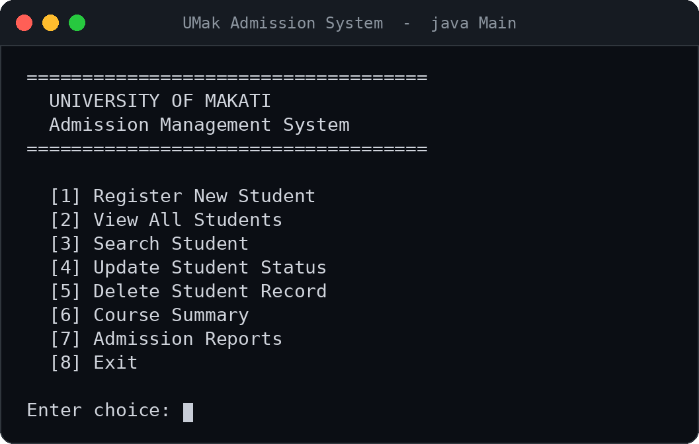
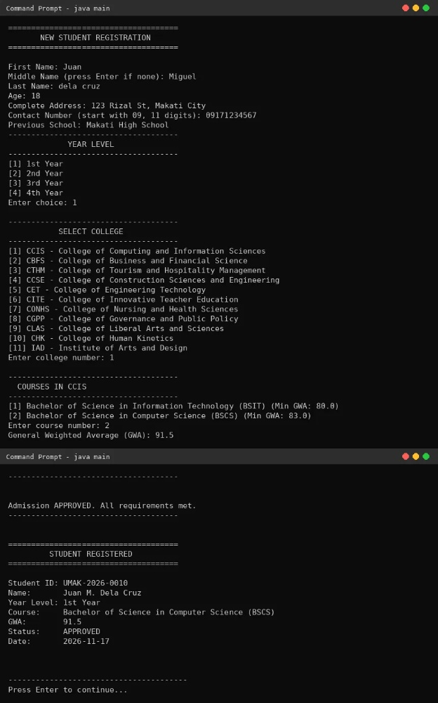
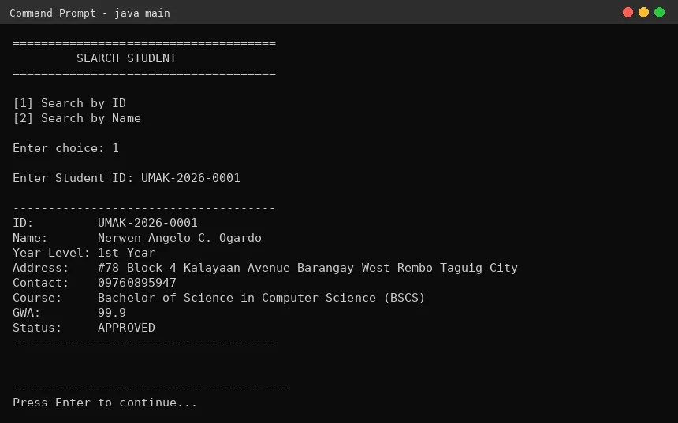
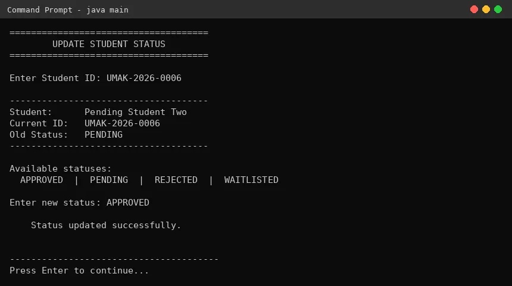
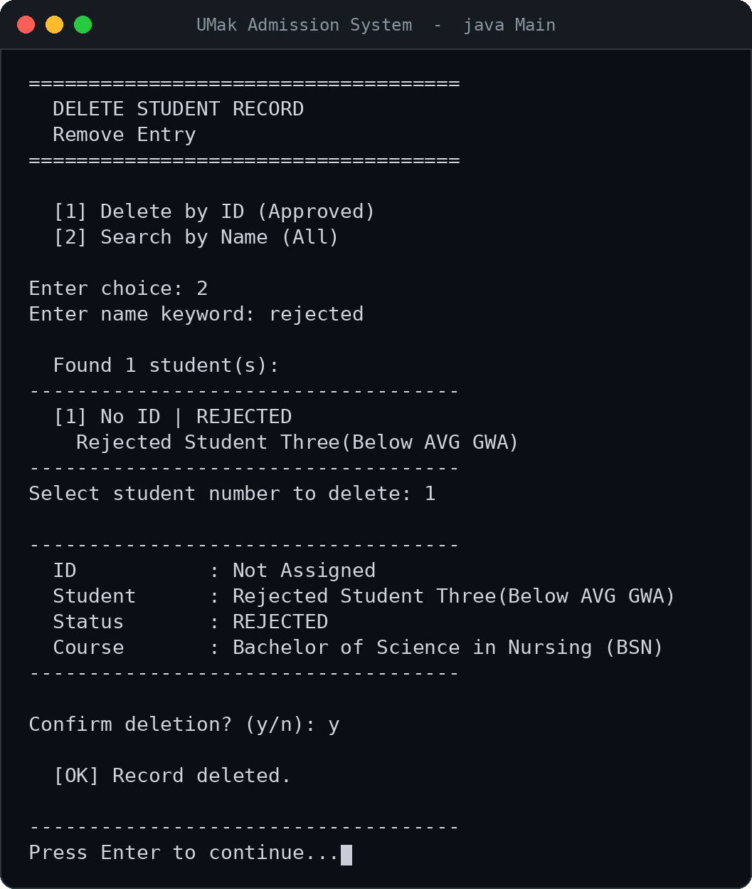
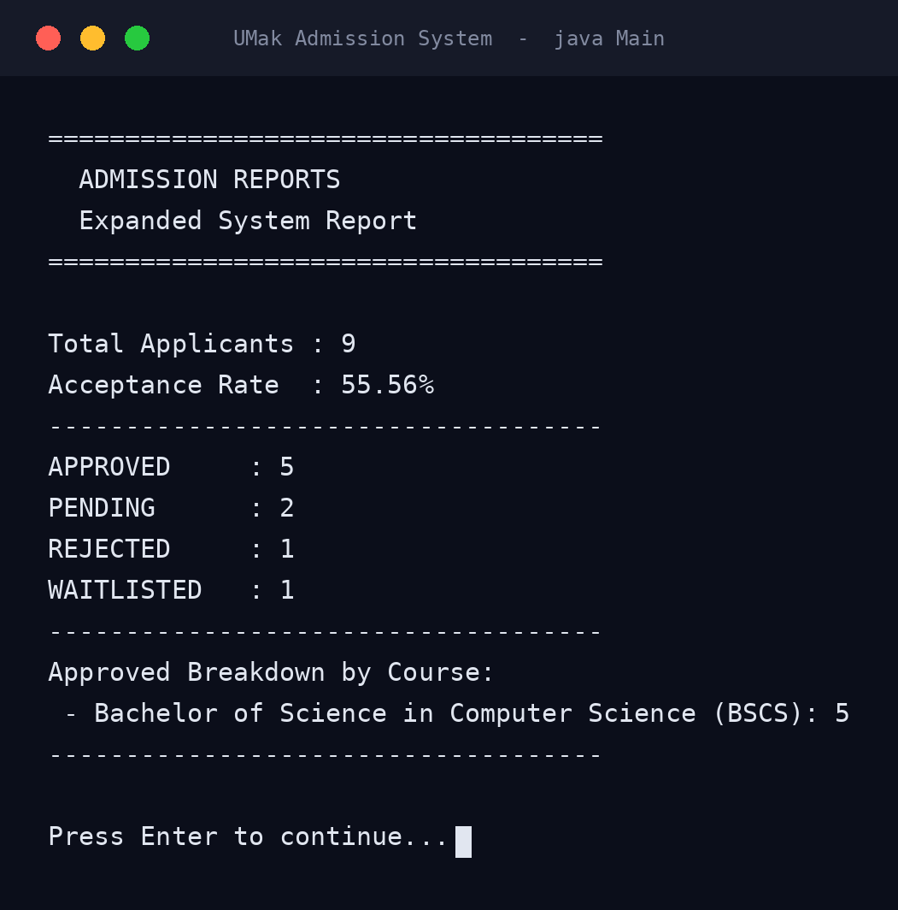

# Project Documentation

## 1. Project Title
**University of Makati (UMak) Admission Management System**

---

## 2. System Description
The **University of Makati (UMak) Admission Management System** is a console-based Java application designed to automate and streamline the student admissions workflow. 

Manual admission processing often suffers from slow document verification, human error in checking minimum grade requirements, and poor tracking of available course slots. This system addresses those problems by verifying mandatory and optional admission requirements upfront, automatically evaluating applicant eligibility based on General Weighted Average (GWA) thresholds and real-time course capacity limits, assigning official Student IDs (`UMAK-YYYY-XXXX`) exclusively upon approval, and persistently storing all records in CSV format (`students.csv`) for administrative reporting.

---

## 3. Objectives
* **Enforce Document Verification:** Screen applicants using a two-step registration workflow that distinguishes between mandatory (`[REQ]`) and optional/to-follow (`[OPT]`) admission documents.
* **Automate Admission Evaluation:** Classify applicants as `APPROVED`, `PENDING`, `WAITLISTED`, or `REJECTED` based on predefined college course minimum GWA requirements, document completeness, and slot availability.
* **Centralize Student Records:** Provide a structured system to register, view, search (by ID or name), update, and delete applicant records with persistent CSV storage (`students.csv`).
* **Manage Real-Time Course Capacity:** Dynamically track total and remaining slots across 11 colleges and 31 academic programs, assigning official Student IDs only when an applicant is approved.
* **Generate Actionable Reports:** Summarize enrollment statistics, acceptance yield rates, and course breakdowns with one-click CSV report exporting (`Admission_Report.csv`).

---

## 4. Features
1. **Register New Student (2-Step Verification & Preview):**
   * **Step 1 (Requirements Checker):** Validates applicant names and runs a batch document checklist (`Notice of Admission`, `Medical Certificate`, `Form 138 / Report Card`, `Form 137`, `Good Moral Certificate`, `PSA Birth Certificate`, `2x2 ID Picture`). Missing mandatory documents block registration; missing optional documents mark the application as conditional (`PENDING`).
   * **Step 2 (Profile, Course & Application Preview):** Collects age, address, Philippine mobile contact (`09XXXXXXXXX`), previous school, year level, college, course, and GWA, then displays a full Application Preview with the predicted admission outcome before confirmation.
2. **View All Students:**
   * Displays a formatted directory of all registered applicants showing their Student ID (or `Not Assigned`), full name, year level, chosen course, GWA, admission status, admission date, and total record count.
3. **Search Student:**
   * Supports exact lookup by **Student ID** (displaying complete profile details including address and contact number) or partial, case-insensitive keyword search by **Student Name**.
4. **Update Student Status:**
   * Allows searching by either **Student ID** or **Name keyword** (with a numbered selection list for multiple matches) to modify an applicant's status (`APPROVED`, `PENDING`, `REJECTED`, `WAITLISTED`).
   * Automatically assigns an official `UMAK-YYYY-XXXX` Student ID and increments taken slots when an applicant is newly promoted to `APPROVED`, or frees a slot if an approved student's status is changed.
5. **Delete Student Record:**
   * Allows searching by **Student ID** or **Name keyword** with confirmation before removal, automatically freeing up an occupied course slot if the deleted student was `APPROVED`.
6. **Course Summary:**
   * Displays available slots (or `FULL`) and minimum GWA requirements for every offered course, organized neatly under each of the 11 UMak colleges.
7. **Admission Reports & CSV Export:**
   * Calculates total applicants, overall acceptance rate ($\text{Approved} / \text{Total} \times 100\%$), status counts, and a per-course breakdown of approved students, with optional export to `Admission_Report.csv`.
8. **Automatic CSV Persistence & Preloaded Sample Data:**
   * Loads existing records from `students.csv` on startup, synchronizes the `rawIDSequence` counter, preloads sample applicants if no CSV exists, and saves every change immediately.

---

## 5. Java Concepts Used
* **Object-Oriented Programming (OOP):**
  * **Encapsulation:** Private fields with public getters and setters in `Student.java`, `CourseRequirement.java`, and `AdmissionService.java`.
  * **Method Overloading:** Overloaded `updateStudentStatus` and `registerNewStudent` methods in `AdmissionService.java` supporting both ID-based and object-based workflows.
  * **Separation of Concerns:** Console UI (`Main.java`), Input Helper (`Checker.java`), Business Logic & CSV Persistence (`AdmissionService.java`), Data Models (`Student.java`, `CourseRequirement.java`), and Constants (`College.java`, `YearLevel.java`).
* **Enumerations (`enum`):**
  * `College` and `YearLevel` enums with custom fields (`fullName`, `displayName`) and constructors for type-safe categorization.
* **Java Collections Framework:**
  * `ArrayList` for dynamic storage of `Student` objects, college lists, and search results.
  * `HashMap` for $O(1)$ lookup of `CourseRequirement` rules, total course capacities, and taken slot counters.
* **File I/O & CSV Parsing:**
  * `BufferedReader`, `FileReader`, `PrintWriter`, and `FileWriter` with `try-with-resources` blocks for safe reading and writing of `students.csv` and `Admission_Report.csv`.
* **Regular Expressions (Regex) & String Manipulation:**
  * Pattern matching for name validation (`^[a-zA-Z\s'-]+$`), contact number validation (`^09\d{9}$`), CSV comma-splitting outside quotes, `String.format` zero-padding, and `StringBuilder` formatting.
* **Exception Handling:**
  * `try-catch` blocks handling `NumberFormatException` for invalid numeric inputs and `IOException` for file operations.
* **Java Time API (`java.time.LocalDate`):**
  * Capturing admission dates and dynamically generating the current year for Student IDs.

---

## 6. Sample Screenshots
* **Main Menu Module:**
  

* **Register New Student Module (Step 1: Requirements Checker & Step 2: Profile & Preview):**
  
  

* **View All Students Module:**
  

* **Search Student Module (By ID & By Name):**
  
  

* **Update & Delete Student Modules:**
  
  

* **Course Summary & Admission Reports:**
  
  

---

## 7. Source Code
The complete `.java` source code is organized across the following files in the repository ([NA0r3n/SchoolAdmission-JavaBased-System](https://github.com/NA0r3n/SchoolAdmission-JavaBased-System/)):

```text
SchoolAdmission-JavaBased-System/
├── Main.java                 # Entry point, CLI menus, 2-step registration & input validation
├── Checker.java              # Utility class for strict boolean (true/false) console input validation
├── AdmissionService.java     # Core business logic, GWA/slot evaluation, deferred ID generation & CSV I/O
├── Student.java              # Data model representing an applicant's profile, nullable ID, and status
├── CourseRequirement.java    # Data model linking courses to colleges, min GWA, and max slots
├── College.java              # Enum defining all 11 UMak colleges and their full names
├── YearLevel.java            # Enum defining 1st to 4th year levels and display labels
└── students.csv              # Auto-generated database file storing student records
```

### How to Compile and Run
1. Clone the repository:
   ```bash
   git clone https://github.com/NA0r3n/SchoolAdmission-JavaBased-System.git
   cd SchoolAdmission-JavaBased-System
   ```
2. Compile all Java files:
   ```bash
   javac *.java
   ```
3. Run the application:
   ```bash
   java Main
   ```