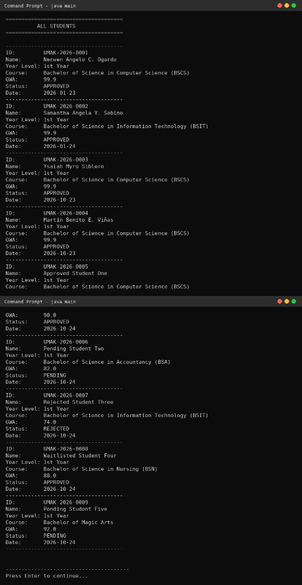
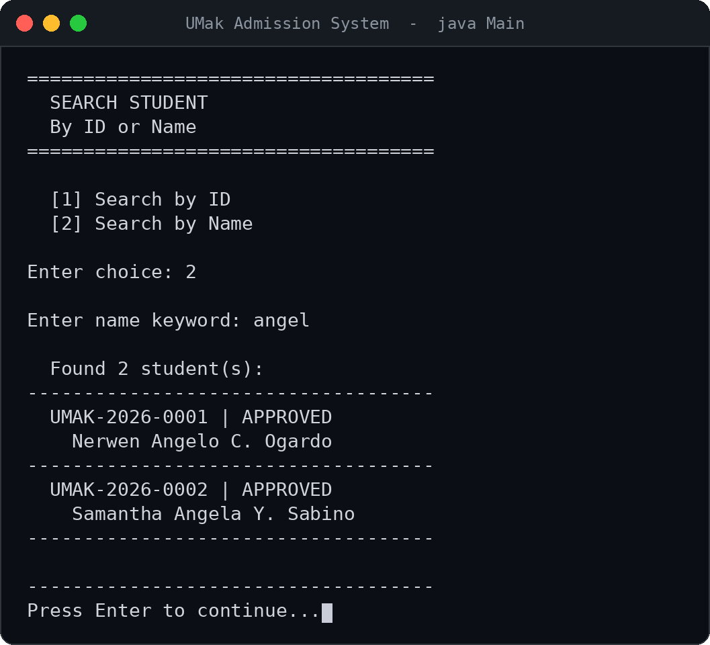
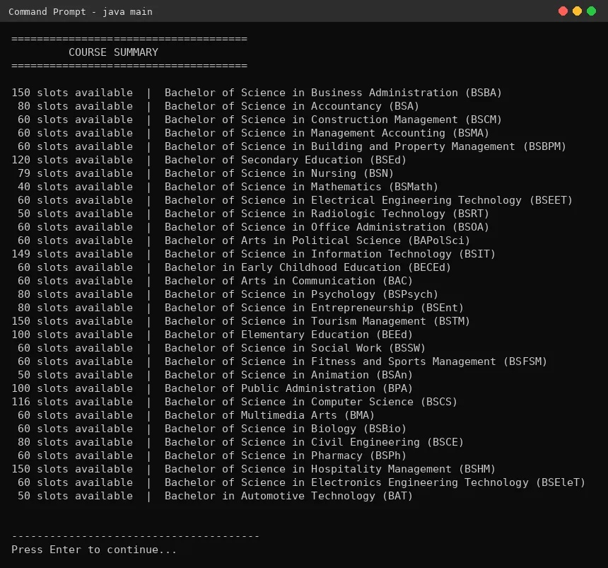

# University of Makati (UMak) - School Admission System

[](https://www.oracle.com/java/)
[](https://github.com/NA0r3n/SchoolAdmission-JavaBased-System/)

---

## 1. Project Title
**University of Makati (UMak) School Admission System**

---

## 2. System Description
The **University of Makati (UMak) School Admission System** is a console-based Java application designed to automate and streamline the student admissions workflow. 

Manual admission processing often suffers from slow applicant evaluation, human error in checking minimum grade requirements, and poor tracking of available course slots. This system addresses those problems by automatically evaluating applicant eligibility based on General Weighted Average (GWA) thresholds and real-time course capacity limits, assigning unique student IDs, and persistently storing all records in CSV format for administrative reporting.

---

## 3. Objectives
* **Automate Admission Evaluation:** Instantly classify applicants as `APPROVED`, `PENDING`, `WAITLISTED`, or `REJECTED` based on predefined college course minimum GWA requirements and slot availability.
* **Centralize Student Records:** Provide a structured system to register, view, search, update, and delete applicant records with persistent CSV storage (`students.csv`).
* **Real-Time Capacity Management:** Dynamically track total and remaining slots across 11 colleges and 31 academic programs to prevent over-enrollment.
* **Generate Actionable Reports:** Summarize enrollment statistics, acceptance yield rates, and course breakdowns with one-click CSV report exporting (`Admission_Report.csv`).
* **Enforce Data Integrity:** Validate user inputs (names, Philippine mobile numbers, age ranges, and GWA bounds) at the console level to prevent malformed records.

---

## 4. Features
1. **Register New Student:**
   * Collects personal details, academic history, year level, college, course selection, and GWA.
   * Performs input validation using regular expressions (names and `09XXXXXXXXX` contact numbers) and numeric range checks.
   * Automatically generates a formatted Student ID (`UMAK-YYYY-XXXX`) and determines admission status based on GWA and slot availability.
2. **View All Students:**
   * Displays a formatted list of all registered applicants along with their Student ID, full name, year level, chosen course, GWA, admission status, and admission date.
3. **Search Student:**
   * Supports exact lookup by **Student ID** (displaying complete profile details including address and contact number) or partial, case-insensitive keyword search by **Student Name**.
4. **Update Student Status:**
   * Allows administrators to manually change an applicant's status (`APPROVED`, `PENDING`, `REJECTED`, `WAITLISTED`).
   * Automatically adjusts taken/available course slots when a student moves into or out of `APPROVED` status, blocking approval if a course is already at full capacity.
5. **Delete Student Record:**
   * Removes a student record after confirmation and automatically frees up an occupied course slot if the deleted student was `APPROVED`.
6. **Course Summary:**
   * Displays the real-time count of remaining available slots for every offered course across all colleges.
7. **Admission Reports & CSV Export:**
   * Calculates total applicants, overall acceptance rate ($\text{Approved} / \text{Total} \times 100\%$), status counts, and a per-course breakdown of approved students.
   * Allows exporting the summary metrics directly to `Admission_Report.csv`.
8. **Automatic CSV Persistence & Preloaded Sample Data:**
   * Automatically loads existing records from `students.csv` upon startup, generates sample student records if no file exists yet, and saves every change immediately.

---

## 5. Java Concepts Used
* **Object-Oriented Programming (OOP):**
  * **Encapsulation:** Private fields with public getters and setters in `Student.java`, `CourseRequirement.java`, and `AdmissionService.java`.
  * **Separation of Concerns:** UI/Console interaction (`main.java`), Business Logic & File Persistence (`AdmissionService.java`), Data Models (`Student.java`, `CourseRequirement.java`), and Constants (`College.java`, `YearLevel.java`).
* **Enumerations (`enum`):**
  * `College` and `YearLevel` enums with custom fields (`fullName`, `displayName`) and constructors for type-safe categorization.
* **Java Collections Framework:**
  * `ArrayList` for dynamic storage of `Student` objects and search results.
  * `HashMap` for $O(1)$ lookup of `CourseRequirement` rules, total course capacities, and taken slot counters.
* **File I/O & CSV Parsing:**
  * `BufferedReader`, `FileReader`, `PrintWriter`, and `FileWriter` with `try-with-resources` blocks for safe reading and writing of `students.csv` and `Admission_Report.csv`.
* **Regular Expressions (Regex) & String Manipulation:**
  * Pattern matching for name validation (`^[a-zA-Z\s'-]+$`), contact number validation (`^09\d{9}$`), CSV comma-splitting outside quotes, and `StringBuilder` for name formatting.
* **Exception Handling:**
  * `try-catch` blocks handling `NumberFormatException` for invalid menu/numeric inputs and `IOException` for file operations.
* **Java Time API (`java.time.LocalDate`):**
  * Capturing and formatting admission dates and dynamically generating the current year for Student IDs.

---

## 6. Sample Screenshots
* **Main Menu Module:** `![Main Menu]## 6. Sample Screenshots

* **Main Menu Module:**
  

* **Register New Student Module:**
  

* **View All Students Module:**
  

* **Search Student Module (By ID & By Name):**
  
  

* **Update & Delete Student Modules:**
  
  

* **Course Summary & Admission Reports:**
  
  


---

## 7. Source Code & Repository Structure
The complete `.java` source code is hosted in the repository: [NA0r3n/SchoolAdmission-JavaBased-System](https://github.com/NA0r3n/SchoolAdmission-JavaBased-System/)

```text
SchoolAdmission-JavaBased-System/
├── main.java                 # Entry point, CLI menu navigation, and input validation
├── AdmissionService.java     # Core business logic, GWA evaluation, slot tracking, and CSV I/O
├── Student.java              # Data model representing an applicant's profile and status
├── CourseRequirement.java    # Data model linking courses to colleges, min GWA, and max slots
├── College.java              # Enum defining all 11 UMak colleges and their full names
├── YearLevel.java            # Enum defining 1st to 4th year levels and display labels
└── students.csv              # Auto-generated database file storing student records
```

### How to Compile and Run
1. Clone the repository:
   ```bash
   git clone https://github.com/NA0r3n/SchoolAdmission-JavaBased-System.git
   cd SchoolAdmission-JavaBased-System
   ```
2. Compile all Java files:
   ```bash
   javac *.java
   ```
3. Run the application:
   ```bash
   java main
   ```
