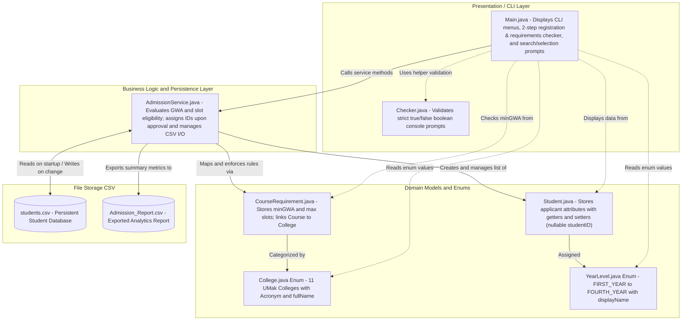
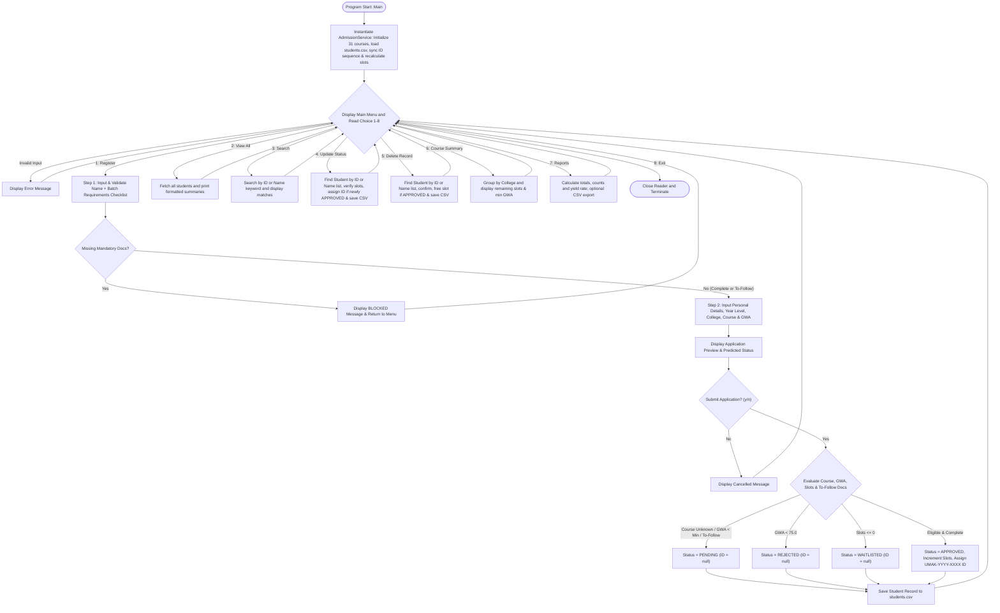

# System Flowcharts & File-by-File Pseudocode

## 1. System Architecture & Role of Individual Files (Mermaid)

This diagram illustrates how the seven `.java` source files interact with one another and with external CSV storage.



---

## 2. Main System Execution Flowchart (Mermaid)

This flowchart details the updated runtime lifecycle from program startup through the two-step document verification and registration preview, deferred ID generation upon approval, and name/ID selection workflows.



---

## 3. Pseudocode for Each Source File

### 3.1 `Main.java`
```text
BEGIN CLASS Main
    CONSTANT DIVIDER = "------------------------------------"
    CONSTANT HEADER_LINE = "===================================="
    CONSTANT REQUIRED_DOCS = [
        "Notice of Admission", "Medical Certificate", "Form 138 / Report Card",
        "Form 137", "Good Moral Certificate", "PSA Birth Certificate", "2x2 ID Picture"
    ]
    CONSTANT IS_MANDATORY = [true, false, true, false, false, true, false]

    FUNCTION isValidName(name)
        RETURN name IS NOT NULL AND name IS NOT BLANK AND name MATCHES "^[a-zA-Z\s'-]+$"
    END FUNCTION

    FUNCTION isValidContact(contact)
        RETURN contact IS NOT NULL AND contact MATCHES "^09\d{9}$"
    END FUNCTION

    FUNCTION capitalizeName(text)
        IF text IS NULL OR BLANK THEN RETURN text
        SPLIT trimmed text by whitespace into words
        FOR EACH word IN words
            APPEND uppercase(first letter) + lowercase(remaining letters) + " " to result
        END FOR
        RETURN trimmed result
    END FUNCTION

    PROCEDURE printBanner(title, subtitle)
        PRINT HEADER_LINE, title, optional subtitle, HEADER_LINE
    END PROCEDURE

    PROCEDURE printSection(title)
        PRINT DIVIDER, title, DIVIDER
    END PROCEDURE

    FUNCTION readIntInRange(input, prompt, min, max)
        LOOP FOREVER
            PRINT prompt
            TRY
                PARSE line AS INTEGER value
                IF value >= min AND value <= max THEN RETURN value
                PRINT "[!] Enter min to max."
            CATCH NumberFormatException
                PRINT "[!] Invalid input. Enter a number."
            END TRY
        END LOOP
    END FUNCTION

    FUNCTION checkRequirementsBatch(input)
        INITIALIZE submitted[0..6] = TRUE
        DISPLAY numbered REQUIRED_DOCS with [REQ] or [OPT] tags
        LOOP FOREVER
            READ line ("Missing items: ")
            IF line IS EMPTY OR line EQUALS "none" OR line EQUALS "0" THEN
                RETURN submitted
            END IF
            RESET submitted[0..6] = TRUE
            SPLIT line by commas/spaces into tokens
            VALIDATE each token is an integer in 1..7 and SET submitted[num - 1] = FALSE
            IF all tokens valid THEN RETURN submitted
            PRINT "[!] Enter numbers 1-7 or 'none'."
        END LOOP
    END FUNCTION

    PROCEDURE pause(input)
        PRINT DIVIDER and "Press Enter to continue..."
        READ line from input
    END PROCEDURE

    PROCEDURE clearScreen()
        PRINT ANSI escape codes to clear console
    END PROCEDURE

    PROCEDURE printStudentSummary(s)
        PRINT ID (or "Not Assigned"), Name, Year Level, Course, GWA, Status, Date Admitted
    END PROCEDURE

    PROCEDURE printCompactStudentRow(prefix, s)
        PRINT prefix, StudentID (or "No ID"), Status, and FullName
    END PROCEDURE

    PROCEDURE main(args)
        CREATE service = NEW AdmissionService()
        CREATE input = NEW BufferedReader(System.in)
        SET running = TRUE

        WHILE running IS TRUE
            CALL clearScreen()
            CALL printBanner("UNIVERSITY OF MAKATI", "Admission Management System")
            DISPLAY Menu Options [1] through [8]
            TRY
                READ choice AS INTEGER
            CATCH NumberFormatException
                PRINT "[!] Invalid input. Enter a number."
                CALL pause(input)
                CONTINUE LOOP
            END TRY

            SWITCH choice
                CASE 1: // Register New Student (2-Step Process)
                    // Step 1: Document Verification
                    PROMPT AND VALIDATE firstName, optional middleName, lastName using isValidName()
                    FORMAT fullName using capitalizeName() and middle initial
                    CALL submitted = checkRequirementsBatch(input)
                    PARTITION missing items into missingMandatory and toFollowDocs
                    DISPLAY Evaluation Result ([BLOCKED] and [TO-FOLLOW] items)
                    IF missingMandatory IS NOT EMPTY THEN
                        PRINT "[!] REGISTRATION BLOCKED - Submit mandatory documents first."
                        CALL pause(input)
                        BREAK
                    END IF
                    CALL pause(input)

                    // Step 2: Profile & Course
                    CALL clearScreen()
                    READ age = readIntInRange(input, "Age (1-100): ", 1, 100)
                    PROMPT address
                    PROMPT AND VALIDATE contact using isValidContact()
                    PROMPT prevSchool
                    READ yearChoice = readIntInRange(input, "Enter choice: ", 1, 4)
                    DISPLAY colleges from service.getAllColleges() AND read collegeIndex
                    DISPLAY courses for selectedCollege with Min GWA AND read courseIndex
                    PROMPT AND VALIDATE gwa (0.0 to 99.9)

                    // Application Preview
                    FETCH req = service.getCourseRequirement(courseApplied)
                    FETCH remainingSlots = service.getCourseSummary().getOrDefault(courseApplied, 0)
                    DISPLAY Application Preview & predicted Result (PENDING / REJECTED / WAITLISTED / APPROVED)
                    PROMPT "Submit application? (y/n): "
                    IF confirmApplication NOT EQUALS "y" (ignore case) THEN
                        PRINT "Application cancelled."
                    END IF
                    CALL pause(input)

                CASE 2: // View All Students
                    GET allStudents = service.getAllStudents()
                    IF allStudents IS EMPTY THEN
                        PRINT "No student records found."
                    ELSE
                        FOR EACH s IN allStudents
                            CALL printStudentSummary(s)
                        END FOR
                        PRINT "Total Records: " + allStudents.size()
                    END IF
                    CALL pause(input)

                CASE 3: // Search Student
                    READ searchChoice = readIntInRange(input, "Enter choice: ", 1, 2)
                    IF searchChoice == 1 THEN
                        PROMPT id; CALL found = service.searchByID(id)
                        DISPLAY full student profile OR "Student not found."
                    ELSE
                        PROMPT keyword; CALL results = service.searchByName(keyword)
                        DISPLAY compact rows OR "No matching students found."
                    END IF
                    CALL pause(input)

                CASE 4: // Update Student Status
                    READ updateChoice = readIntInRange(input, "Enter choice: ", 1, 2)
                    FIND studentToUpdate via searchByID() OR numbered list from searchByName()
                    IF studentToUpdate IS NULL THEN
                        PRINT "Student not found."
                    ELSE
                        DISPLAY current record & status options (APPROVED, PENDING, REJECTED, WAITLISTED)
                        PROMPT newStatus (uppercase)
                        CALL updated = service.updateStudentStatus(studentToUpdate, newStatus)
                        IF updated THEN
                            PRINT "[OK] Status updated."
                            IF newStatus == "APPROVED" AND studentID IS NOT NULL THEN PRINT New ID
                        ELSE
                            PRINT "[!] Update failed. Check status or slots."
                        END IF
                    END IF
                    CALL pause(input)

                CASE 5: // Delete Student Record
                    READ deleteChoice = readIntInRange(input, "Enter choice: ", 1, 2)
                    FIND studentToDelete via searchByID() OR numbered list from searchByName()
                    IF studentToDelete IS NULL THEN
                        PRINT "Student not found."
                    ELSE
                        DISPLAY student details AND PROMPT "Confirm deletion? (y/n): "
                        IF confirmDelete EQUALS "y" (ignore case) THEN
                            SET targetKey = studentID if not null else fullName
                            CALL service.deleteStudent(targetKey)
                            PRINT "[OK] Record deleted."
                        ELSE
                            PRINT "Deletion cancelled."
                        END IF
                    END IF
                    CALL pause(input)

                CASE 6: // Course Summary
                    GET summary = service.getCourseSummary()
                    FOR EACH college IN service.getAllColleges()
                        CALL printSection(college + " - " + college.fullName)
                        FOR EACH course IN service.getCoursesByCollege(college)
                            PRINT course, remaining slots (or "FULL"), and Min GWA
                        END FOR
                    END FOR
                    CALL pause(input)

                CASE 7: // Admission Reports
                    CALL service.generateExpandedReport()
                    CALL pause(input)

                CASE 8: // Exit
                    PRINT Goodbye banner
                    SET running = FALSE

                DEFAULT:
                    PRINT "[!] Invalid choice. Try again."
                    CALL pause(input)
            END SWITCH
        END WHILE
        CLOSE input
    END PROCEDURE
END CLASS
```

---

### 3.2 `Checker.java`
```text
BEGIN CLASS Checker
    FUNCTION getBooleanInput(input, question)
        LOOP FOREVER
            PRINT question
            READ answer = trimmed line from input
            IF answer EQUALS "true" (ignore case) THEN RETURN TRUE
            IF answer EQUALS "false" (ignore case) THEN RETURN FALSE
            PRINT "Invalid input! Please enter only 'true' or 'false'."
        END LOOP
    END FUNCTION
END CLASS
```

---

### 3.3 `AdmissionService.java`
```text
BEGIN CLASS AdmissionService
    PRIVATE students = NEW List<Student>
    PRIVATE courseRequirements = NEW Map<String, CourseRequirement>
    PRIVATE courseSlots = NEW Map<String, Integer>
    PRIVATE courseTakenSlots = NEW Map<String, Integer>
    PRIVATE rawIDSequence = 1
    PRIVATE CONSTANT STUDENT_CSV = "students.csv"

    CONSTRUCTOR AdmissionService()
        CALL initializeCourses()
        CALL loadStudentsFromCSV()
        IF students IS EMPTY THEN
            CALL createSampleStudents()
        END IF
        CALL recalculateSlotCounts()
    END CONSTRUCTOR

    PRIVATE PROCEDURE initializeCourses()
        FOR EACH of the 31 UMak degree programs
            CALL addCourse(NEW CourseRequirement(courseName, college, minGWA, maxSlots))
        END FOR
    END PROCEDURE

    PRIVATE PROCEDURE addCourse(req)
        PUT (req.courseName, req) INTO courseRequirements
        PUT (req.courseName, req.slots) INTO courseSlots
        PUT (req.courseName, 0) INTO courseTakenSlots
    END PROCEDURE

    FUNCTION getAllColleges()
        RETURN List of all College enum values
    END FUNCTION

    FUNCTION getCoursesByCollege(college)
        INITIALIZE empty list courses
        FOR EACH req IN courseRequirements.values()
            IF req.college == college THEN ADD req.courseName TO courses
        END FOR
        RETURN courses
    END FUNCTION

    FUNCTION getCourseRequirement(courseName)
        RETURN courseRequirements.get(courseName)
    END FUNCTION

    PRIVATE PROCEDURE createSampleStudents()
        CALL registerPreloadedStudent(...) for 9 sample applicants
        CALL saveStudentsToCSV()
    END PROCEDURE

    FUNCTION registerNewStudent(fullName, age, address, contact, prevSchool, courseApplied, gwa, yearLevel, isPreloaded)
        GET req = courseRequirements.get(courseApplied)
        SET studentID = NULL

        // Automated Status & ID Evaluation Logic (ID assigned only when APPROVED)
        IF req IS NULL THEN
            SET status = "PENDING"
        ELSE IF gwa < 75.0 THEN
            SET status = "REJECTED"
        ELSE IF gwa < req.minGWA THEN
            SET status = "PENDING"
        ELSE IF courseTakenSlots.get(courseApplied) >= courseSlots.get(courseApplied) THEN
            SET status = "WAITLISTED"
        ELSE
            SET status = "APPROVED"
            INCREMENT courseTakenSlots for courseApplied by 1
            SET studentID = "UMAK-" + CurrentYear + "-" + ZERO_PAD(rawIDSequence++, 4)
        END IF

        CREATE newStudent = NEW Student(studentID, fullName, courseApplied)
        SET newStudent attributes (status, age, address, contact, prevSchool, gwa, yearLevel, dateAdmitted = TODAY)
        ADD newStudent TO students
        CALL saveStudentsToCSV()
        RETURN newStudent
    END FUNCTION

    FUNCTION getAllStudents()
        RETURN students
    END FUNCTION

    FUNCTION searchByID(id)
        FOR EACH s IN students
            IF s.studentID IS NOT NULL AND s.studentID EQUALS id THEN RETURN s
        END FOR
        RETURN NULL
    END FUNCTION

    FUNCTION searchByName(keyword)
        INITIALIZE empty list results
        FOR EACH s IN students
            IF lowercase(s.fullName) CONTAINS lowercase(keyword) THEN ADD s TO results
        END FOR
        RETURN results
    END FUNCTION

    FUNCTION updateStudentStatus(id, newStatus)
        GET student = searchByID(id)
        IF student IS NULL THEN RETURN FALSE
        RETURN updateStudentStatus(student, newStatus)
    END FUNCTION

    FUNCTION updateStudentStatus(student, newStatus)
        IF student IS NULL THEN RETURN FALSE
        SET oldStatus = student.status
        SET course = student.courseApplied
        GET req = courseRequirements.get(course)

        IF oldStatus != "APPROVED" AND newStatus == "APPROVED" THEN
            IF req IS NULL OR courseTakenSlots.get(course) >= courseSlots.get(course) THEN
                RETURN FALSE // Unknown course or full capacity
            END IF
            INCREMENT courseTakenSlots for course by 1
            IF student.studentID IS NULL THEN
                SET newId = "UMAK-" + CurrentYear + "-" + ZERO_PAD(rawIDSequence++, 4)
                CALL student.setStudentID(newId)
            END IF
        ELSE IF oldStatus == "APPROVED" AND newStatus != "APPROVED" THEN
            DECREMENT courseTakenSlots for course by 1
        END IF

        SET student.status = newStatus
        CALL saveStudentsToCSV()
        RETURN TRUE
    END FUNCTION

    FUNCTION deleteStudent(id)
        GET student = searchByID(id)
        IF student IS NOT NULL THEN
            IF student.status == "APPROVED" THEN
                DECREMENT courseTakenSlots for student.courseApplied by 1
            END IF
            REMOVE student FROM students
            CALL saveStudentsToCSV()
            RETURN TRUE
        END IF
        RETURN FALSE
    END FUNCTION

    FUNCTION getCourseSummary()
        INITIALIZE summary Map
        FOR EACH course IN courseSlots.keySet()
            PUT (course, courseSlots.get(course) - courseTakenSlots.get(course)) INTO summary
        END FOR
        RETURN summary
    END FUNCTION

    PROCEDURE generateExpandedReport()
        COUNT total, approved, pending, rejected, waitlisted, and approved per course
        CALCULATE yieldRate = (total == 0) ? 0 : (approved / total) * 100
        DISPLAY formatted report summary and course breakdown
        CALL promptExport(total, approved, pending, rejected, waitlisted, yieldRate)
    END PROCEDURE

    PROCEDURE promptExport(total, approved, pending, rejected, waitlisted, yieldRate)
        PROMPT "Press [E] to export this report to CSV, or press Enter to skip"
        IF choice EQUALS "E" (ignore case) THEN
            WRITE metrics to "Admission_Report.csv"
        END IF
    END PROCEDURE

    PRIVATE PROCEDURE recalculateSlotCounts()
        RESET all courseTakenSlots values to 0
        FOR EACH s IN students
            IF s.status == "APPROVED" AND courseTakenSlots CONTAINS s.courseApplied THEN
                INCREMENT courseTakenSlots for s.courseApplied by 1
            END IF
        END FOR
    END PROCEDURE

    PRIVATE PROCEDURE saveStudentsToCSV()
        OPEN PrintWriter on STUDENT_CSV
        WRITE CSV header row
        FOR EACH s IN students
            WRITE formatted CSV row for s
        END FOR
    END PROCEDURE

    PRIVATE PROCEDURE loadStudentsFromCSV()
        IF STUDENT_CSV DOES NOT EXIST THEN RETURN
        OPEN BufferedReader on STUDENT_CSV
        SKIP header row
        WHILE line = br.readLine() IS NOT NULL
            PARSE CSV columns (handling quoted commas)
            SET idToStore = NULL if studentID is blank else studentID
            RECONSTRUCT Student object and ADD to students
            IF studentID IS NOT BLANK THEN
                EXTRACT sequence number from studentID and UPDATE rawIDSequence if seq >= rawIDSequence
            END IF
        END WHILE
    END PROCEDURE
END CLASS
```

---

### 3.4 `Student.java`
```text
BEGIN CLASS Student
    PRIVATE studentID, fullName, address, contact, prevSchool, courseApplied, status AS STRING
    PRIVATE age AS INTEGER
    PRIVATE gwa AS DOUBLE
    PRIVATE dateAdmitted AS LocalDate
    PRIVATE yearLevel AS YearLevel

    CONSTRUCTOR Student(studentID, fullName, courseApplied)
        SET this.studentID = studentID
        SET this.fullName = fullName
        SET this.courseApplied = courseApplied
        SET this.dateAdmitted = TODAY
    END CONSTRUCTOR

    // Standard Getters and Setters for all private attributes:
    // get/setStudentID(), getFullName(), get/setStatus(), get/setAge(),
    // get/setAddress(), get/setContact(), get/setPrevSchool(),
    // get/setGrades() [for gwa], getCourseApplied(),
    // get/setDateAdmitted(), get/setYearLevel()
END CLASS
```

---

### 3.5 `CourseRequirement.java`
```text
BEGIN CLASS CourseRequirement
    PRIVATE courseName AS STRING
    PRIVATE college AS College
    PRIVATE minGWA AS DOUBLE
    PRIVATE slots AS INTEGER

    CONSTRUCTOR CourseRequirement(courseName, college, minGWA, slots)
        SET this.courseName = courseName
        SET this.college = college
        SET this.minGWA = minGWA
        SET this.slots = slots
    END CONSTRUCTOR

    // Standard Getters:
    // getCourseName(), getCollege(), getMinGWA(), getSlots()
END CLASS
```

---

### 3.6 `College.java`
```text
BEGIN ENUM College
    CONSTANTS:
        CCIS("College of Computing and Information Sciences"),
        CBFS("College of Business and Financial Science"),
        CTHM("College of Tourism and Hospitality Management"),
        CCSE("College of Construction Sciences and Engineering"),
        CET("College of Engineering Technology"),
        CITE("College of Innovative Teacher Education"),
        CONHS("College of Nursing and Health Sciences"),
        CGPP("College of Governance and Public Policy"),
        CLAS("College of Liberal Arts and Sciences"),
        CHK("College of Human Kinetics"),
        IAD("Institute of Arts and Design")

    PUBLIC FINAL fullName AS STRING

    CONSTRUCTOR College(fullName)
        SET this.fullName = fullName
    END CONSTRUCTOR
END ENUM
```

---

### 3.7 `YearLevel.java`
```text
BEGIN ENUM YearLevel
    CONSTANTS:
        FIRST_YEAR("1st Year"),
        SECOND_YEAR("2nd Year"),
        THIRD_YEAR("3rd Year"),
        FOURTH_YEAR("4th Year")

    PUBLIC FINAL displayName AS STRING

    CONSTRUCTOR YearLevel(displayName)
        SET this.displayName = displayName
    END CONSTRUCTOR
END ENUM
```